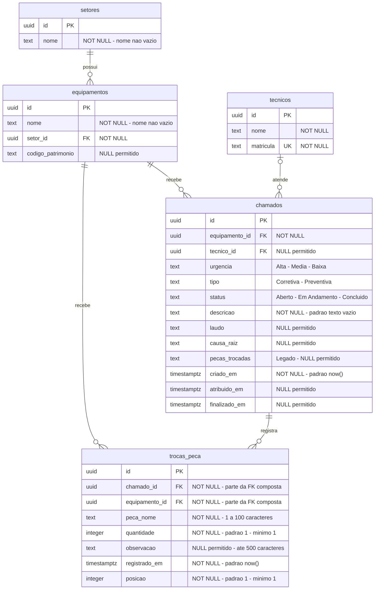

# Modelo de Dados (DER) — Segunda entrega (N2)

Data: 27/10/2026.

Modelo físico do PostgreSQL usado na segunda entrega, incluindo os cadastros da
N1 e o registro estruturado de peças. Os nomes e tipos abaixo correspondem às
migrations `001_schema_inicial.sql` e `002_posicao_troca_peca.sql`.

## 1. Entidades e relacionamentos implementados



Cardinalidades:

- Um setor pode possuir zero ou muitos equipamentos; cada equipamento pertence
  obrigatoriamente a um setor.
- Um equipamento pode possuir zero ou muitos chamados; cada chamado pertence
  obrigatoriamente a um equipamento.
- Um técnico pode atender zero ou muitos chamados; um chamado tem zero ou um
  técnico. Não há exigência de técnico para conclusão no schema atual.
- Um chamado pode registrar zero ou muitas trocas; cada troca pertence a um
  único chamado e ao mesmo equipamento desse chamado.
- Não existe tabela de catálogo de peças: o nome é armazenado em cada troca.
  O técnico do histórico é obtido por meio do chamado, sem FK direta de troca
  para técnico e sem identificação de usuário autenticado nesta entrega.

## 2. Chaves e restrições físicas

Todas as entidades de domínio têm `id` UUID com chave primária e valor padrão
`gen_random_uuid()`.

### Vínculo entre chamado, equipamento e troca

`chamados` possui a restrição `UNIQUE (id, equipamento_id)`. A tabela
`trocas_peca` referencia essa combinação por meio da FK composta:

```sql
FOREIGN KEY (chamado_id, equipamento_id)
    REFERENCES chamados (id, equipamento_id)
```

Além disso, `trocas_peca.equipamento_id` referencia diretamente
`equipamentos.id`. Assim, o banco impede que uma troca seja registrada para um
equipamento diferente daquele associado ao chamado. As FKs não configuram
exclusão em cascata.

### Domínios e validações

- `setores.nome` e `equipamentos.nome` são obrigatórios e não podem ficar vazios
  após `trim`.
- `tecnicos.matricula` é obrigatória e única. Nome de setor e código de
  patrimônio não possuem restrição de unicidade.
- `chamados.urgencia`, `tipo` e `status` são obrigatórios e limitados por `CHECK`.
  Os valores reais de status são `Aberto`, `Em Andamento` e `Concluído`.
- O tipo padrão do chamado é `Corretiva`; o status padrão é `Aberto`.
- `trocas_peca.peca_nome` exige de 1 a 100 caracteres após `trim`.
- `quantidade` é `integer`, com mínimo 1; o limite superior do tipo é 2147483647.
  A aplicação valida esse intervalo antes da gravação.
- `observacao`, quando não nula, aceita até 500 caracteres.
- `posicao` deve ser maior ou igual a 1. A aplicação preenche 1, 2, 3 etc. na
  ordem enviada; o banco não declara unicidade de posição por chamado.
- Laudo, causa raiz, peças em texto e datas de atribuição/conclusão aceitam
  `NULL` no banco. A interface exigir um campo não cria uma restrição equivalente
  no PostgreSQL; a API atualmente normaliza textos ausentes na conclusão para `''`.

Os nomes em `snake_case` são os nomes físicos do banco. A API devolve, por
exemplo, `equipamentoId`, `pecaNome` e `registradoEm`; `trocas` é uma lista
montada pela consulta, não uma coluna JSON de `chamados`.

## 3. Regra crítica e transações

A regra preservada da N1 é: cada técnico pode ter no máximo dois chamados
`Alta` nos status `Aberto` ou `Em Andamento` simultaneamente.

A implementação atual usa PostgreSQL: `atribuirChamado` abre uma transação,
bloqueia o chamado e a linha do técnico com `SELECT ... FOR UPDATE`, conta a
carga e aceita ou rejeita a atribuição. A contagem não é mais feita em arrays
em memória. Trata-se de uma regra da aplicação protegida por transação, não de
um `CHECK` agregado no schema; gravações SQL que ignorem esse fluxo não são
protegidas por um trigger equivalente.

A conclusão e todas as trocas são gravadas na mesma transação. Se uma gravação
falhar, o rollback desfaz as alterações dessa tentativa. A conclusão também
bloqueia a linha do chamado para impedir duas conclusões concorrentes.

## 4. View de carga e índices

A view `tecnicos_com_carga` expõe `id`, `nome`, `matricula` e
`chamados_alta_abertos`. A carga é calculada a partir de `chamados`; não é um
contador persistido em `tecnicos` nem uma nova entidade de domínio.

Índices adicionais das migrations:

- `chamados_tecnico_status_idx`: `(tecnico_id, status)`.
- `chamados_equipamento_criado_idx`: `(equipamento_id, criado_em)`.
- `trocas_peca_equipamento_idx`: `(equipamento_id, registrado_em DESC)`.

O histórico usa `registrado_em DESC, posicao ASC`. As peças retornadas dentro
de um chamado usam `registrado_em ASC, posicao ASC`. Os campos de data são
`timestamptz`; a API serializa os instantes em ISO 8601 UTC.

## 5. Controle de migrations

A tabela técnica `migracoes` é criada pelo executor em `backend/src/db/migrar.js`:

- `nome`: `text`, chave primária, identifica o arquivo SQL aplicado.
- `aplicada_em`: `timestamptz`, obrigatório, com padrão `now()`.

Ela não possui relacionamentos com as entidades de domínio. Cada migration é
aplicada em transação e registrada para evitar reaplicação no próximo boot.
Os dados locais ficam em `backend/.pgdata`; com `DATABASE_URL`, é usada a base
externa informada.

## 6. Fora do modelo implementado nesta entrega

Não existem tabelas de usuários, perfis, permissões ou agendamentos preventivos
no schema atual. O cálculo de MTBF e o agendamento automático de preventivas
permanecem fora da segunda entrega. Por isso, entidades futuras não estão
misturadas ao DER implementado, e nenhuma fórmula de MTBF é estabelecida aqui.

## 7. Fontes e critérios de aceite

- [Schema inicial](../../backend/migrations/001_schema_inicial.sql).
- [Posição das trocas](../../backend/migrations/002_posicao_troca_peca.sql).
- [Executor de migrations](../../backend/src/db/migrar.js).
- [Serviço de chamados e histórico](../../backend/src/services/chamadoService.js).
- [Contrato da API](../contratos/trocas-e-historico.md).
- [Critérios de aceite da segunda entrega](../requisitos/criterios-aceite-n2.md).
