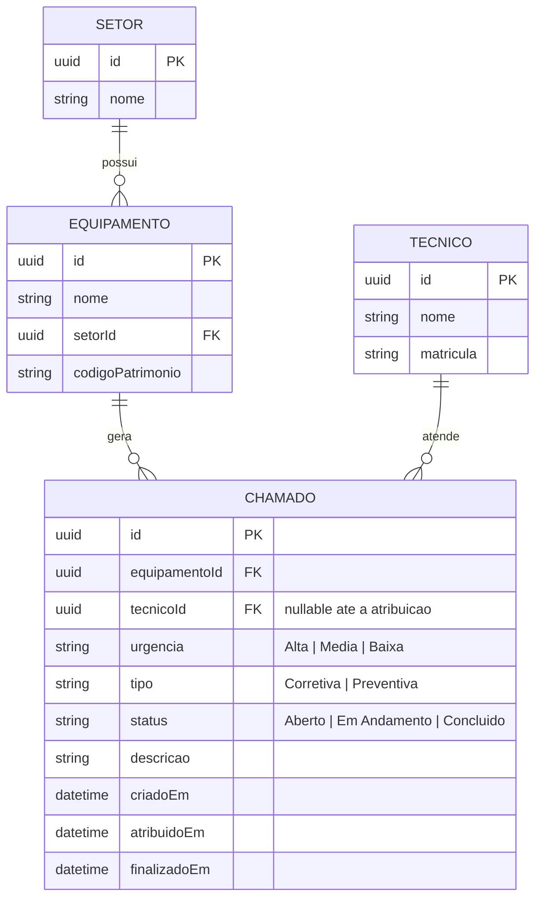
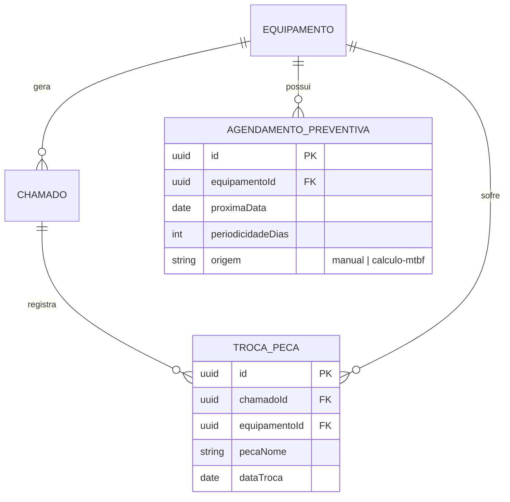

# Modelo de Dados (DER) — Helpdesk de Manutenção Industrial

## Escopo N1 (implementado)

### Regra de negócio crítica representada no modelo

`CHAMADO.urgencia = 'Alta' AND CHAMADO.status IN ('Aberto','Em Andamento')`
agrupado por `tecnicoId` não pode ultrapassar **2 registros simultâneos**.
Na N1 essa contagem é feita em memória (`contarChamadosAltaAbertos`); em
produção, com banco relacional, isso deveria virar uma constraint de
aplicação (transação) ou um `CHECK`/trigger, pois SQL puro não expressa bem
"no máximo N linhas relacionadas" via constraint declarativa simples.

## Visão de evolução N2/N3 (não implementada nesta entrega)

- **MTBF (Tempo Médio Entre Falhas)** = soma dos intervalos entre falhas
  corretivas consecutivas do mesmo equipamento / número de falhas no
  período. Requer histórico consistente de `CHAMADO` por `EQUIPAMENTO`
  (já suportado pela FK `equipamentoId` desde a N1).
- **Agendamento automático de preventivas** consome o MTBF calculado para
  sugerir `proximaData` em `AGENDAMENTO_PREVENTIVA`.
